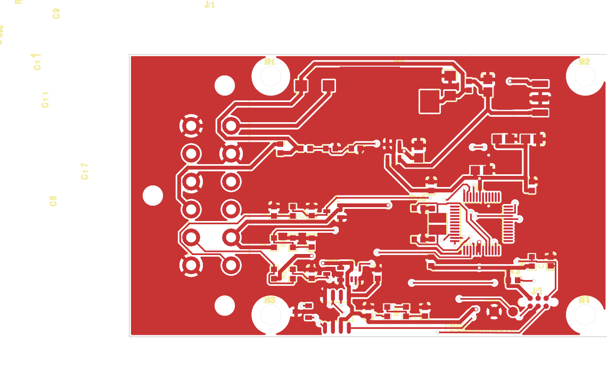

# ByteShift Fuel Center

An automotive CAN module that reads fuel pressure, fuel temperature and ethanol content and puts them on the
bus at 100 Hz.



- **Sensors:** GM 13577429 flex fuel sensor (ethanol %, fuel temperature) and Honeywell MIP 0-150 psi
  pressure sensor (EFI Hardware H-PS150G-HMIP).
- **Output:** CAN 500 kbit/s, ID 0x5A6 every 10 ms, CRC-8 and rolling counter in every frame.
- **Fails safe:** any fault reports 0 % ethanol and 0 kPa *and* sets an error flag, so a broken sensor or wire
  can never look like high ethanol or present pressure.
- **Hardware:** NXP S32K116, AEC-qualified parts throughout, sealed Deutsch DT 12-way connector,
  JLCPCB-ready fabrication and assembly files.

Rev A boards have been manufactured and verified.

## Design rules

1. **Automotive-grade, every part.** Fuel matters and the engine bay is hostile. Aftermarket boards commonly use
   commercial or industrial parts rated to 70 or 85 °C. Every electronic part on this board is AEC-qualified, the
   same standard carmakers require: AEC-Q100 ICs, AEC-Q101 discretes and AEC-Q200 passives, all rated for at least
   −40 to 125 °C. The connector is a sealed Deutsch DT.
2. **Fail safe.** Every fault fails toward low ethanol and no pressure, and is flagged. Every frame carries a
   CRC-8 and a rolling counter so the receiver can reject bad frames and detect a dead module.
3. **Ready to order.** Every part must be in stock at JLCPCB when the design is updated; an exotic part helps
   no one. Download, upload to JLCPCB, order. `python3 hardware/check_stock.py` checks current stock.

## Documentation

| | |
|---|---|
| [docs/protocol.md](docs/protocol.md) | CAN frames, CRC-8, configuration |
| [docs/hardware.md](docs/hardware.md) | Schematic overview, pinouts, ordering, installation |
| [docs/firmware.md](docs/firmware.md) | Build, test, flash |
| [docs/sensors.md](docs/sensors.md) | Sensor wiring, signals and fault behaviour |

## Quick start

```sh
make -C firmware test          # host unit tests
make -C firmware/s32k116       # target firmware (Arm GNU toolchain)
python3 hardware/check_stock.py 50   # JLCPCB stock for 50 boards
```

To order boards, follow [docs/hardware.md#ordering](docs/hardware.md#ordering).

Open `hardware/kicad/fuel-center.kicad_pro` in KiCad 8 or later.

## Disclaimer

This module feeds data to engine management. Validate it on your own vehicle and use it at your own risk.

## License

Copyright (C) 2026 ByteShift Labs LLC

- Firmware and documentation: [GPL-3.0-or-later](LICENSE)
- Hardware (`hardware/`): [CERN-OHL-S-2.0](hardware/LICENSE)

Third-party files keep their own terms: NXP device support in `firmware/s32k116/nxp/`
([BSD-3-Clause](firmware/s32k116/nxp/LICENSE)) and the component library in `hardware/lib/` (see its
[README](hardware/lib/README.md)).
